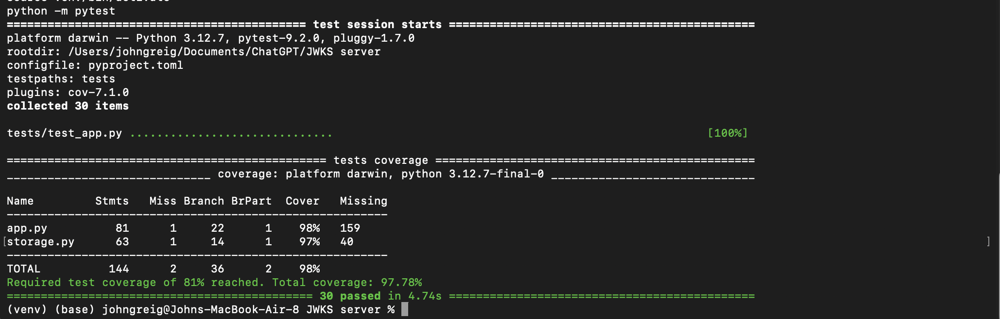
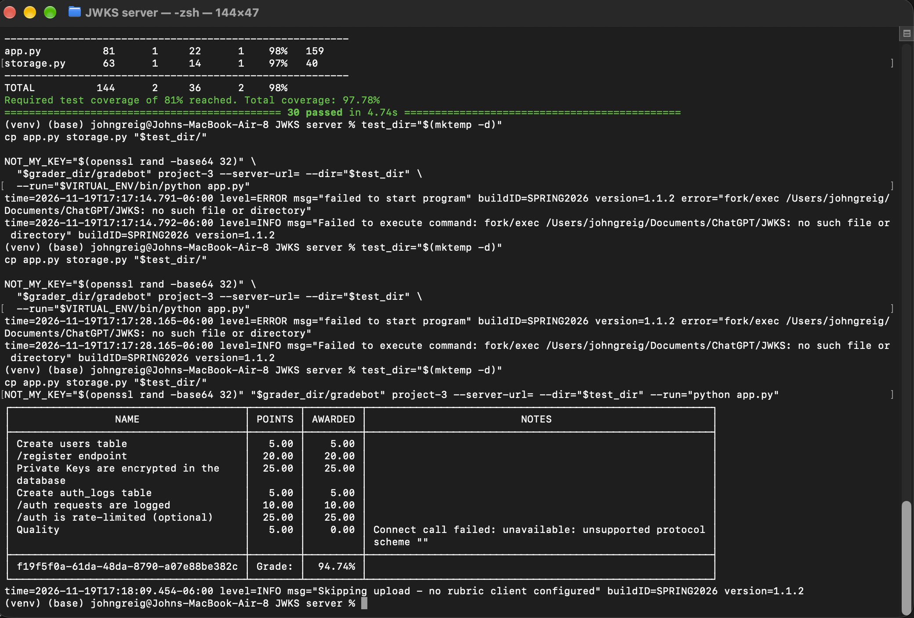
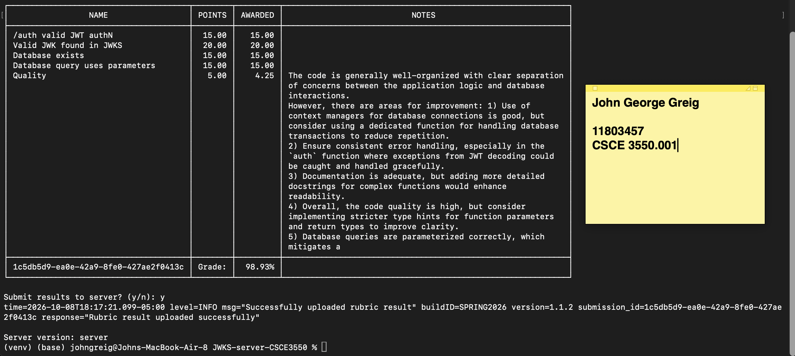

# SQLite JWKS and Mock Authentication Server

A Python/Flask server for CSCE 3550 Project 3. It issues RS256 JWTs, encrypts
RSA private keys in SQLite, registers users, and logs mock authentication requests.

## Setup and execution

Requires Python 3.10+. SQLite support is included in Python's standard library;
no separate SQLite server or Python package is needed.

```bash
python3 -m venv venv
source venv/bin/activate
pip install -r requirements.txt
export NOT_MY_KEY="$(openssl rand -base64 32)"
python app.py
```

Set `NOT_MY_KEY` to 32 random bytes encoded as standard Base64. Generate this
value once for a new database, save it in a secret manager, and supply the same
value on every restart. Keep it out of Git. Startup fails if the key is missing,
invalid, or unable to decrypt existing keys.

Run from the repository directory. The server listens on port 8080 and creates
`totally_not_my_privateKeys.db` in the **current working directory**. The blackbox
client must run from that same directory (or use matching directory/database
arguments).

## Persistent storage

`storage.py` creates the required schema:

```sql
CREATE TABLE IF NOT EXISTS keys(
    kid INTEGER PRIMARY KEY AUTOINCREMENT,
    key BLOB NOT NULL,
    exp INTEGER NOT NULL
);
```

Private keys are serialized as PKCS1 PEM, then encrypted using AES-256-GCM.
Each BLOB contains a version marker, a fresh 12-byte nonce, the ciphertext, and
its authentication tag. Expiration is an integer Unix timestamp. Startup
ensures there is at least one key expired one hour ago and one active key
expiring one hour later. Existing keys and IDs
are retained across restarts; no duplicate seed keys are added when both
categories already exist. If a category is missing during authentication, a new
key is saved and then read back from SQLite before signing.

All query values are passed as bound parameters, without string interpolation.
Connections are closed explicitly, and writes use transactions. JWT/JWK `kid`
values are strings containing the integer database ID.

Startup migrates Project 2 plaintext key rows in a transaction, preserving their
IDs and expiration times. Any backups taken before migration still contain
plaintext keys. The database and its SQLite sidecars are excluded from Git.

## Endpoints

### `GET /.well-known/jwks.json`

Reads **all** keys with `exp > now` from SQLite and returns their public RSA
components in a JSON Web Key Set. Private PEM bytes never appear in the response.

### `POST /auth`

Reads an active private key and returns a raw signed JWT (`text/plain`). Claims
include `exp`, `iat`, `iss` (`jwks-server`), and `sub` (the supplied username, or
`user123` by default). Token expiration matches the stored key expiration.

The **presence** of the `expired` query parameter selects an expired key:
`/auth?expired`, `/auth?expired=true`, and `/auth?expired=false` all issue expired
JWTs. Expired keys are excluded from JWKS.

Both HTTP Basic auth and JSON `{ "username": "userABC", "password": "password123" }`
are accepted. The course endpoint continues to issue mock JWTs without checking
passwords. Successful requests record the connection IP, UTC timestamp, and
matching registered user ID in `auth_logs`. Unregistered usernames have a
`NULL` user ID. Each server process accepts up to 10 `POST /auth` requests in any
one-second window. Excess requests return HTTP 429 with `Retry-After: 1`.

```bash
curl -X POST -u userABC:password123 http://localhost:8080/auth
curl -X POST -H 'Content-Type: application/json' \
  -d '{"username":"userABC","password":"password123"}' http://localhost:8080/auth
curl -X POST 'http://localhost:8080/auth?expired=true'
curl http://localhost:8080/.well-known/jwks.json
```

### `POST /register`

Accepts a JSON object with `username` and `email` and returns HTTP 201 with the
generated UUIDv4 password. The `users` table stores a salted Argon2id hash.
Duplicate usernames or emails return HTTP 409. Missing or invalid fields return
HTTP 400.

```bash
curl -X POST -H 'Content-Type: application/json' \
  -d '{"username":"student","email":"student@example.com"}' http://localhost:8080/register
```

## Tests and lint

```bash
python -m pytest
ruff check .
ruff format --check .
```

Tests use isolated databases and generated test keys. They cover encrypted key
storage, migration, invalid keys, JWKS signature verification, registration,
Argon2id hashes, auth logging, rate limits, and the existing JWT behavior.
`pyproject.toml` enables line/branch coverage for both modules and enforces a
minimum of 81%, above the assignment's 80% requirement.

The Project 3 test run on macOS with Python 3.12.7 passed all 30 tests
with **97.78% combined line and branch coverage**.



## Blackbox client

Download and extract the appropriate binary from the
[official releases](https://github.com/jh125486/CSCE3550/releases).
From the repository directory with the virtual environment active and
`NOT_MY_KEY` exported, run the Project 3 checks locally:

```bash
/path/to/gradebot project-3 --server-url= --dir=. --run="python app.py"
```

The client starts the server on port 8080. The database stays in this directory
so the client can inspect it. Passing an empty `--server-url` disables uploading
and leaves the remote quality review unscored.

Gradebot v1.1.2 awarded **90/90 functional points**, including the optional
rate limiter. The local report displayed **94.74%** overall with the five-point
remote quality review unscored.



## Layout

- `app.py`: application factory and HTTP endpoints.
- `storage.py`: schema initialization, parameterized queries, and key persistence.
- `tests/test_app.py`: automated regression tests.
- `requirements.txt`: runtime and development dependencies.
- `pyproject.toml`: pytest, coverage, and lint settings.
- `screenshot.png`: project grading evidence.

## Project 2 grading history

The run scored **98.93%** and was successfully submitted to the
grading server. The screenshot includes the results table.


